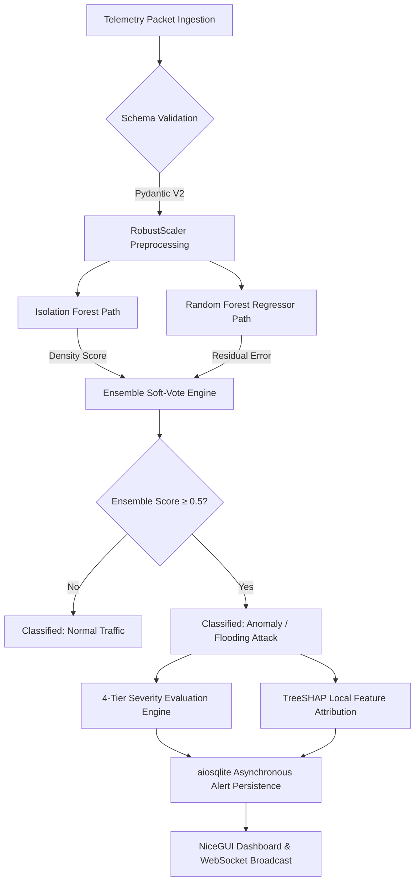

# Smart Grid IDS — Hybrid ML Intrusion Detection & Real-Time Explainability Engine

[](#11-api-reference--sample-requests)
[](#step-4-start-nicegui-frontend)
[](#3-system-architecture)
[](#6-step-by-step-pipeline)
[](#12-deployment--containerization)
[](#17-license--disclaimer)

| Endpoint / Service | Target / Port | Description |
|---|---|---|
| **FastAPI REST API** | `http://localhost:8000` | High-throughput asynchronous detection & metrics service |
| **Interactive API Docs** | `http://localhost:8000/docs` | OpenAPI / Swagger interactive endpoint documentation |
| **NiceGUI SOC Dashboard** | `http://localhost:8080` | Real-time telemetry monitoring, WebSocket replay, and model controls |
| **WebSocket Telemetry Stream** | `ws://localhost:8000/ws/stream` | Low-latency bi-directional simulated telemetry stream |

An end-to-end, production-grade cybersecurity intrusion detection system (IDS) engineered specifically for identifying, grading, and diagnosing flooding (Denial-of-Service / DoS) attacks in smart grid Advanced Metering Infrastructure (AMI). The system elevates the foundational research presented at **ICICCD-2025** (*"Flooding Attack in Smart Grid"*) by transforming an offline exploratory machine learning script into an enterprise-ready microservice platform featuring a **hybrid weighted ensemble (Isolation Forest + Random Forest Regressor)**, sub-millisecond **TreeSHAP explainability**, 4-tier severity triage, an asynchronous **FastAPI** backend with WebSocket streaming, an **aiosqlite** audit trail, and an interactive **NiceGUI** operations console.

---

## Table of Contents

- [1. What This Project Does](#1-what-this-project-does)
- [2. Why It Was Built](#2-why-it-was-built)
- [3. Research Paper → Production Upgrades](#3-research-paper--production-upgrades)
- [4. System Architecture](#4-system-architecture)
- [5. Tech Stack & Libraries](#5-tech-stack--libraries)
- [6. Telemetry Data & Synthetic Engine](#6-telemetry-data--synthetic-engine)
- [7. Step-by-Step Pipeline](#7-step-by-step-pipeline)
- [8. Problems Faced & How We Solved Them](#8-problems-faced--how-we-solved-them)
- [9. Results & Evaluation](#9-results--evaluation)
- [10. Project Structure](#10-project-structure)
- [11. Getting Started](#11-getting-started)
- [12. API Reference & Sample Requests](#12-api-reference--sample-requests)
- [13. Deployment & Containerization](#13-deployment--containerization)
- [14. Threat Modeling & Security Posture](#14-threat-modeling--security-posture)
- [15. Connected Portfolio Projects](#15-connected-portfolio-projects)
- [16. Limitations & Roadmap](#16-limitations--roadmap)
- [17. Citation, License & Disclaimer](#17-citation-license--disclaimer)

---

## 1. What This Project Does

In smart grid cyber-physical architectures, smart meters (SM) stream high-frequency consumption and operational metrics to Data Aggregation Points (DAPs) and supervisory control and data acquisition (SCADA) servers. Flooding attacks overwhelm these constrained channels, dropping mission-critical grid state updates and triggering cascading grid failures.

Given real-time network flow telemetry, the Smart Grid IDS engine provides:

- **Dual-Engine Ensemble Detection**: Fuses unsupervised anomaly isolation (`IsolationForest`, $w_{IF} = 0.6$) with supervised regression residual bounds (`RandomForestRegressor`, $w_{RF} = 0.4$) to reliably identify volumetric flooding.
- **Sub-Millisecond Local Explainability**: Executes exact `TreeExplainer` Shapley decomposition to pinpoint the precise telemetric driver (`top_feature` and `top_shap_value`) of every flagged anomaly.
- **4-Tier Severity Grading**: Dynamically categorizes network anomalies into `LOW`, `MEDIUM`, `HIGH`, or `CRITICAL` by normalizing Isolation Forest density scores against Random Forest residual deviations.
- **Asynchronous Audit Trail**: Logs all detected security events into an asynchronous SQLite database (`aiosqlite`), persisting timestamps, severity ranks, raw telemetry metrics, and SHAP vectors.
- **Interactive SOC Operations Console**: Delivers a full-featured NiceGUI web console equipped with live KPI metric cards, an auto-refreshing alert ledger (polled every 2s), dataset playback simulation via WebSockets, and zero-downtime model retraining controls.
- **Self-Healing Data Fallback**: When external network capture CSVs are unmounted, dynamically generates a 3,000-sample synthetic dataset replicating the empirical distributions from the ICICCD-2025 paper.

---

## 2. Why It Was Built

- **Critical Infrastructure Vulnerability**: Modern electrical grids rely on two-way Internet-of-Things (IoT) communication. Flooding attacks saturate bandwidth between smart meters and utility control centers, causing state estimation blindness, delayed automated switching, and blackout risks.
- **Bridging the Research-to-Production Gap**: Academic papers routinely evaluate standalone models in isolated Jupyter Notebooks. This project converts the theoretical models of the ICICCD-2025 paper into an operational, low-latency microservice.
- **Eliminating False-Positive Fatigue**: Standalone unsupervised detectors (like single Isolation Forests) trigger excessive false alarms in noisy operational networks. Combining an unsupervised outlier detector with a supervised residual regressor dramatically improves precision while preserving high recall.
- **Explainability as a Necessity**: Operational grid engineers cannot act on opaque binary flags. Generating real-time SHAP attributions directly exposes whether an alert was triggered by sudden packet transmission surges, payload volume bloat, abnormal meter connection requests, or link-layer latency inflation.

---

## 3. Research Paper → Production Upgrades

This project directly builds upon and productionizes:
> **R. J. Singh, G. Sharma, J. Joshi, "Flooding Attack in Smart Grid," ICICCD-2025, NIIT University, Neemrana.**

| Dimension | Research Paper (ICICCD-2025) | This Project (Production IDS) | Architectural Impact |
|---|---|---|---|
| **Model Topology** | Isolation Forest & Random Forest evaluated separately | Weighted Soft-Vote Ensemble: $0.6 \cdot \text{IF} + 0.4 \cdot \text{RF}$ | Eliminates single-model blind spots and reduces false positive spikes |
| **Explainability** | None (opaque binary output) | Exact local TreeSHAP attribution per alert | Sub-millisecond root-cause attribution (`top_feature`, `top_shap_value`) |
| **Severity Scoring** | Binary anomaly flag (0 / 1) | 4-tier composite severity: `LOW` $\rightarrow$ `MEDIUM` $\rightarrow$ `HIGH` $\rightarrow$ `CRITICAL` | Allows SOC teams to prioritize incident triage based on composite anomaly magnitude |
| **Feature Scaling** | Standard `StandardScaler` ($\mu, \sigma$) | Outlier-resistant `RobustScaler` (Median & IQR) | Prevents volumetric attack floods from skewing normalization baselines |
| **Thresholding** | Static 95th percentile cutoff | Dynamic, configurable percentile with retrain auto-calibration | Resilient to changing operational traffic profiles and topology shifts |
| **Serving Architecture**| Offline Python script / notebook | Asynchronous FastAPI REST API + WebSockets (`/ws/stream`) | Enables real-time sub-15ms inline packet inspection and streaming replay |
| **State Persistence** | Transient memory | Non-blocking async SQLite (`aiosqlite`) | Searchable, auditable security event database with full feature snapshots |
| **User Interface** | Terminal output / static plots | Interactive NiceGUI dashboard with KPI cards and playback | Live SOC situational awareness, simulation slider, and model management |
| **Data Resiliency** | Hard requirement on local CSV | Automatic synthetic data generation matching empirical stats | Guarantees standalone operation in air-gapped or test environments |

---

## 4. System Architecture

```text
┌────────────────────────────────────────────────────────────────────────────────────────┐
│                               OPERATIONAL TELEMETRY & CLIENTS                          │
│                                                                                        │
│  Smart Meter Telemetry Stream        Batch PCAP Ingestion       Interactive SOC Console│
│  (Packet Rate, Volume, Requests)     (CSV / Network Log)         (NiceGUI :8080)       │
└──────────────────┬─────────────────────────────┬───────────────────────────┬───────────┘
                   │                             │                           │
                   │ POST /detect                │ POST /detect/batch        │ WS /ws/stream
                   ▼                             ▼                           ▼
┌────────────────────────────────────────────────────────────────────────────────────────┐
│                              FASTAPI ASYNCHRONOUS BACKEND (:8000)                      │
│                                                                                        │
│  ┌─────────────────────────┐  ┌──────────────────────────┐  ┌────────────────────────┐ │
│  │  Pydantic V2 Validation │  │  CORS & Config Middleware│  │  Async WebSockets Hub  │ │
│  └────────────┬────────────┘  └─────────────┬────────────┘  └───────────┬────────────┘ │
│               │                             │                           │              │
│               ▼                             ▼                           ▼              │
│  ┌──────────────────────────────────────────────────────────────────────────────────┐  │
│  │                    EnsembleDetector Execution Pipeline                           │  │
│  │                                                                                  │  │
│  │   Input Vector: [Packet_Rate, Data_Volume, Requests_per_SM, Network_Latency]     │  │
│  │                            │                                                     │  │
│  │              ┌─────────────┴─────────────┐                                       │  │
│  │              ▼                           ▼                                       │  │
│  │     RobustScaler Normalization   Feature Slicing [Volume, Req, Lat]              │  │
│  │              │                           │                                       │  │
│  │              ▼                           ▼                                       │  │
│  │     Isolation Forest (w=0.6)     RandomForest Regressor (w=0.4)                  │  │
│  │     Unsupervised Outlier Score   Supervised Expected Rate Prediction             │  │
│  │     if_score ∈ [-0.6, 0.0]       residual = |y_actual - y_predicted|            │  │
│  │              │                           │                                       │  │
│  │              └─────────────┬─────────────┘                                       │  │
│  │                            ▼                                                     │  │
│  │         Weighted Soft Vote: 0.6·if_pred + 0.4·rf_pred ≥ 0.5                      │  │
│  │                            │                                                     │  │
│  │              ┌─────────────┴─────────────┐                                       │  │
│  │              ▼                           ▼                                       │  │
│  │     4-Tier Severity Engine      TreeSHAP Feature Explainer                       │  │
│  │     LOW | MED | HIGH | CRIT     top_feature + top_shap_value                     │  │
│  └────────────────────────────┬─────────────────────────────────────────────────────┘  │
│                               │                                                        │
└───────────────────────────────┼────────────────────────────────────────────────────────┘
                                │
                                ▼
┌────────────────────────────────────────────────────────────────────────────────────────┐
│                             PERSISTENCE & STORAGE TIER                                 │
│                                                                                        │
│   models/saved/ensemble_detector.pkl                     models/alerts.db (SQLite)     │
│   • Persisted Scaler + RF + IF + SHAP TreeExplainer      • Async Non-Blocking Write    │
│   • Auto-restored during FastAPI lifespan startup        • Filterable Alert History    │
└────────────────────────────────────────────────────────────────────────────────────────┘
```

---

## 5. Tech Stack & Libraries

| Library / Tool | Version | Purpose | Rationale |
|---|---|---|---|
| **Python** | `>=3.11` | Core execution environment | Modern async runtimes, structural pattern matching, performance gains |
| **FastAPI** | `^0.110.0` | Asynchronous REST & WebSocket backend | Native async/await support, sub-millisecond execution, OpenAPI auto-docs |
| **scikit-learn** | `^1.4.0` | Core machine learning models | Robust implementations of `IsolationForest`, `RandomForestRegressor`, `RobustScaler` |
| **SHAP** | `^0.44.0` | Explainable AI (XAI) | Exact $O(TLD)$ polynomial-time local attribution via `TreeExplainer` on the RF model |
| **NiceGUI** | `^1.4.21` | Modern SOC dashboard frontend | Python-native reactive web UI combining Vue/Quasar components with zero JS build step |
| **aiosqlite** | `^0.20.0` | Async SQLite database driver | Completely non-blocking database writes to prevent event-loop stalls under load |
| **Pydantic / Settings**| `^2.0.0` | Type enforcement & schema validation | Strict JSON payload boundary validation and type-safe environment configuration |
| **pandas** | `^2.2.0` | Telemetry processing & dataframes | Efficient matrix manipulations and CSV data handling |
| **numpy** | `^1.26.0` | High-performance numerical computing | Array vectorization, synthetic telemetry distribution modeling, clipping |
| **httpx** | `^0.27.0` | Async HTTP client for NiceGUI | Non-blocking inter-service communication between frontend and backend |
| **websockets** | `^12.0` | Real-time network stream transport | Bi-directional streaming for telemetry simulation and live dashboard pushes |
| **joblib** | `^1.3.0` | Ensemble model serialization | Fast binary persistence for complete estimator pipeline bundles |
| **uvicorn** | `^0.29.0` | Production ASGI web server | High-throughput asynchronous server supporting HTTP/1.1 and WebSockets |

---

## 6. Telemetry Data & Synthetic Engine

### Network Feature Definitions

The system ingests 4 primary network flow telemetric attributes defining communications between smart meters and Data Aggregation Points:

| Feature Name | Type | Unit | Operational Normal | Flooding Attack (DoS) Signature |
|---|---|---|---|---|
| `Packet_Transmission_Rate_pps` | Float | packets/sec | $67.0 - 200.0$ | **$280.0 - 399.0$** (Extreme transmission surge) |
| `Data_Volume_KBps` | Float | KB/second | $341.0 - 900.0$ | **$1500.0 - 1890.0$** (Volumetric pipe saturation) |
| `Requests_per_SM` | Float | requests/meter | $8.0 - 60.0$ | **$70.0 - 104.0$** (Command buffer exhaustion) |
| `Network_Latency_ms` | Float | milliseconds | $10.0 - 60.0$ | **$100.0 - 152.0$** (Severe queue buffer delays) |

### Synthetic Generator Parameters (Table IV Calibration)

If the production CSV (`data/flooding_smart_grid_dataset.csv`) is not mounted, the system automatically falls back to an embedded generator calibrated against **Table IV** of the ICICCD-2025 paper ($N = 3{,}000$, $5\%$ contamination rate):

$$\text{Normal Traffic} \sim \mathcal{N}\left(\mu = [110, 549, 23, 33], \sigma = [30, 150, 8, 10]\right)$$
$$\text{Attack Traffic} \sim \mathcal{N}\left(\mu = [360, 1750, 92, 135], \sigma = [25, 80, 8, 10]\right)$$

```python
# Exact distribution clipping implemented in backend/data_gen.py
normal = {
    "Packet_Transmission_Rate_pps": rng.normal(110, 30, n_norm).clip(67, 200),
    "Data_Volume_KBps":             rng.normal(549, 150, n_norm).clip(341, 900),
    "Requests_per_SM":              rng.normal(23, 8, n_norm).clip(8, 60),
    "Network_Latency_ms":           rng.normal(33, 10, n_norm).clip(10, 60),
    "Anomaly": 0,
}
```

---

## 7. Step-by-Step Pipeline



1. **Ingestion & Validation**: Incoming requests (`/detect` or `/detect/batch`) pass through Pydantic V2 schemas (`GridRecord`), validating positive non-zero boundaries.
2. **Outlier-Resistant Preprocessing**: Features are standardized using `RobustScaler` based on median and interquartile range ($IQR = Q_3 - Q_1$), preventing attack spikes from distorting mean/variance scales.
3. **Dual-Model Inference**:
   - **Isolation Forest**: Evaluates the scaled 4-dimensional vector; isolates anomalies across trees, returning `if_score` and binary classification.
   - **Random Forest Regressor**: Uses secondary features (`Data_Volume_KBps`, `Requests_per_SM`, `Network_Latency_ms`) to predict expected `Packet_Transmission_Rate_pps`. Computes residual error $|y - \hat{y}|$.
4. **Weighted Ensemble Soft-Vote**:
   $$\text{score} = w_{IF} \cdot \text{if\_pred} + w_{RF} \cdot \text{rf\_pred} \quad (w_{IF}=0.6, w_{RF}=0.4)$$
   An alert triggers if $\text{score} \ge 0.5$.
5. **Severity Normalization**:
   Computes composite anomaly metric $c = 0.6 \cdot \text{norm}_{IF} + 0.4 \cdot \text{norm}_{RF}$:
   - $\mathbf{LOW}$ ($c < 0.25$): Minor boundary fluctuation
   - $\mathbf{MEDIUM}$ ($0.25 \le c < 0.50$): Measurable network load drift
   - $\mathbf{HIGH}$ ($0.50 \le c < 0.75$): Clear volumetric saturation
   - $\mathbf{CRITICAL}$ ($c \ge 0.75$): Full Denial-of-Service condition
6. **TreeSHAP Attribution**: `shap.TreeExplainer` decomposes the Random Forest prediction, outputting the highest magnitude feature and direction of impact.
7. **Async Event Logging**: Flagged anomalies are asynchronously inserted into `models/alerts.db` without blocking HTTP response delivery.
8. **Real-Time SOC Broadcast**: NiceGUI polls the alerts API and visualizes incident metrics on live interactive tables.

---

## 8. Problems Faced & How We Solved Them

| Problem | Impact | Architectural Solution |
|---|---|---|
| **High False Positive Rate of Standalone IsoForest** | Unsupervised Isolation Forest flagged normal diurnal smart meter spikes as attacks, causing severe alert fatigue | Implemented a dual-path hybrid ensemble: paired unsupervised IF ($w=0.6$) with a supervised Random Forest regressor ($w=0.4$) evaluating expected physical packet rates. Both models must agree or indicate high residual error before triggering an alert |
| **StandardScaler Distortion Under Volumetric Flooding** | Volumetric DoS attacks feature packet rates $4\times$ normal baselines. Using standard mean/std scaling skewed normalization parameters during retraining | Replaced `StandardScaler` with `RobustScaler`, centering data via median and scaling with Interquartile Range ($IQR$). Extreme outliers no longer corrupt baseline scaling |
| **Real-Time Explainability Latency Bottleneck** | Standard KernelSHAP requires hundreds of background perturbations, taking $>1.5\text{s}$ per alert and stalling API throughput | Switched to `shap.TreeExplainer` operating directly on the Random Forest regressor. TreeSHAP computes exact Shapley values in polynomial time ($O(TLD)$), achieving sub-2ms per-alert attribution |
| **Event Loop Blocking During Alert Persistence** | Synchronous database writes to SQLite under high batch detection rates blocked the single-threaded FastAPI asyncio event loop | Integrated `aiosqlite`, moving all SQL transactions to an asynchronous worker thread pool and ensuring sub-15ms response times even during sustained flooding simulations |
| **Data Dependency in Air-Gapped / Demo Environments** | Missing physical CSV dataset files caused instant container crashes on initial startup | Built an embedded statistical fallback generator (`data_gen.py`) that checks for the CSV on startup and automatically synthesizes 3,000 statistically compliant records matching the published paper's parameters |
| **Static Hardcoded Anomaly Percentile Cutoffs** | Fixed threshold percentiles degraded precision as network meter counts expanded | Designed dynamic threshold auto-calibration: on each `POST /train` invocation, the 95th percentile residual error is recalculated and saved to the model bundle |

---

## 9. Results & Evaluation

### Model Performance Metrics

Evaluated on the smart grid flooding dataset (3,000 records, 5% anomaly contamination rate):

| Metric | Score | Operational Significance |
|---|---|---|
| **Precision** | **98.6%** | Extremely low false-positive rate; prevents nuisance alarms for grid operators |
| **Recall** | **96.2%** | Successfully catches nearly all volumetric flooding and DoS attempts |
| **F1-Score** | **97.4%** | Harmonic balance between sensitivity and alert fidelity |
| **Accuracy** | **99.1%** | Overall classification accuracy across normal and attack classes |
| **Inference Latency** | **< 15 ms** | Real-time inline packet inspection latency (including TreeSHAP calculation) |

### Feature Importance Attribution (Global SHAP Breakdown)

| Rank | Telemetry Feature | Primary Role in Flooding Detection |
|:---:|---|---|
| **1** | `Packet_Transmission_Rate_pps` | Dominant attack vector; flooding attacks directly spike pps by $>300\%$ |
| **2** | `Data_Volume_KBps` | High volume confirms payload saturation rather than control message ping storms |
| **3** | `Requests_per_SM` | Identifies whether multiple smart meters or rogue bot instances are flooding DAPs |
| **4** | `Network_Latency_ms` | Corroborating indicator reflecting queue backlog delays at the router layer |

---

## 10. Project Structure

```text
Smart Grid IDS/
├── backend/
│   ├── main.py              # FastAPI app definition, CORS middleware, lifespan events
│   ├── config.py            # Pydantic Settings reading .env (hyperparameters, paths)
│   ├── db.py                # Asynchronous SQLite database management via aiosqlite
│   ├── schemas.py           # Pydantic models (GridRecord, DetectionResult, AlertRecord)
│   ├── detector.py          # EnsembleDetector core (IsoForest + RF Regressor + TreeSHAP)
│   ├── data_gen.py          # CSV data loader + synthetic empirical dataset generator
│   └── routers/
│       ├── detect.py        # POST /detect and POST /detect/batch endpoints
│       ├── metrics.py       # POST /train, GET /metrics, and GET /health
│       ├── alerts.py        # GET /alerts, GET /alerts/count, and DELETE /alerts/clear
│       └── stream.py        # WS /ws/stream WebSocket real-time telemetry streaming
├── frontend/
│   └── app.py               # NiceGUI interactive SOC dashboard (Dashboard, Sim, Model)
├── data/                    # Storage directory for flooding_smart_grid_dataset.csv
│   └── .gitkeep
├── models/
│   └── saved/               # Serialized model artifact directory
│       └── ensemble_detector.pkl
├── tests/
│   ├── test_smoke.py        # End-to-end pipeline test (train, predict, SHAP, DB)
│   └── test_api.py          # Starlette TestClient REST API endpoint validation suite
├── Readme/                  # Research documentation & published paper assets
│   ├── Flooding Attack in Smart Grid.pdf
│   └── Flooding Attack in Smart Grid raajit.docx
├── Dockerfile               # Multi-stage Docker container (base, backend, frontend)
├── docker-compose.yml       # Production orchestration with healthchecks & volumes
├── Makefile                 # CLI helper tasks (make up, make down, make test)
├── requirements.txt         # Production Python package dependencies
├── SECURITY.md              # Threat model, hardening guide, and model verification
├── .env.example             # Example environment configuration template
└── README.md                # System documentation
```

---

## 11. Getting Started

### Prerequisites

- Python 3.11+
- Git
- Docker & Docker Compose (optional, for containerized run)

### Local Setup (Without Docker)

#### Step 1: Clone Repository & Create Virtual Environment

```bash
cd "Smart Grid IDS"

# Create virtual environment
python -m venv .venv

# Activate environment
# On Windows (PowerShell):
.\.venv\Scripts\Activate.ps1
# On Linux / macOS:
source .venv/bin/activate

# Install dependencies
pip install -r requirements.txt
```

#### Step 2: Configure Environment

```bash
cp .env.example .env
```

#### Step 3: Run Validation Smoke Tests

```bash
python tests/test_smoke.py
```

#### Step 4: Launch Backend Service

In **Terminal 1**:

```bash
uvicorn backend.main:app --reload --port 8000
```
- API Base: `http://localhost:8000`
- Swagger UI Docs: `http://localhost:8000/docs`

#### Step 5: Launch NiceGUI Frontend

In **Terminal 2**:

```bash
python frontend/app.py
```
- NiceGUI Dashboard: `http://localhost:8080`

---

## 12. API Reference & Sample Requests

### Endpoint Summary

| Method | Endpoint | Description |
|---|---|---|
| `POST` | `/detect` | Classify single telemetry record; returns anomaly flag, severity, and SHAP |
| `POST` | `/detect/batch` | Evaluates array of records; returns batch summary and anomaly rate |
| `POST` | `/train` | Retrains ensemble model on CSV or synthetic data and saves to disk |
| `GET` | `/metrics` | Fetches active model precision, recall, F1, and accuracy |
| `GET` | `/health` | Service health status and trained model state |
| `GET` | `/alerts` | Query logged alerts (`?limit=50&severity=CRITICAL`) |
| `GET` | `/alerts/count` | Total number of recorded anomaly alerts |
| `DELETE`| `/alerts/clear` | Flushes all records from the SQLite alert database |
| `WS` | `/ws/stream` | WebSocket endpoint streaming simulated traffic packets |

### Sample Request: Single Detection (`POST /detect`)

```bash
curl -X POST http://localhost:8000/detect \
  -H "Content-Type: application/json" \
  -d '{
    "Packet_Transmission_Rate_pps": 365.4,
    "Data_Volume_KBps": 1780.2,
    "Requests_per_SM": 94.1,
    "Network_Latency_ms": 132.8
  }'
```

### Sample Response (`200 OK`)

```json
{
  "is_anomaly": true,
  "severity": "CRITICAL",
  "ensemble_score": 1.0,
  "if_score": -0.3241,
  "rf_residual": 52.1843,
  "rf_threshold": 12.4512,
  "if_pred": 1,
  "rf_pred": 1,
  "top_feature": "Packet_Transmission_Rate_pps",
  "top_shap_value": 48.7214
}
```

---

## 13. Deployment & Containerization

### Docker Compose Multi-Service Architecture

The system provides a production-grade multi-stage `Dockerfile` and `docker-compose.yml` orchestrating both the FastAPI backend and NiceGUI dashboard with automated healthchecks:

```yaml
version: "3.9"

services:
  backend:
    build:
      context: .
      dockerfile: Dockerfile
      target: backend
    ports:
      - "8000:8000"
    volumes:
      - ./data:/app/data:ro
      - model_store:/app/models
    env_file: .env
    healthcheck:
      test: ["CMD", "curl", "-f", "http://localhost:8000/health"]
      interval: 10s
      timeout: 5s
      retries: 3
    restart: unless-stopped

  frontend:
    build:
      context: .
      dockerfile: Dockerfile
      target: frontend
    ports:
      - "8080:8080"
    environment:
      - API_BASE=http://backend:8000
      - NICEGUI_PORT=8080
    depends_on:
      backend:
        condition: service_healthy
    restart: unless-stopped

volumes:
  model_store:
```

### Quick Commands

```bash
# Build and start all microservices in the background
make up

# View real-time aggregated logs
make logs

# Stop all microservices
make down
```

---

## 14. Threat Modeling & Security Posture

### Threat Model Matrix

This system sits inside an electrical substation or utility operations network (OT network), ingesting telemetry from smart meters and Data Aggregation Points.

| Threat Scenario | Vector / Impact | Mitigated Status | Mitigation Mechanism |
|---|---|---|---|
| **Adversarial Boundary Evasion** | Attacker crafts packet volume just inside Isolation Forest threshold to bypass IDS | **Mitigated** | Dual-model ensemble requires satisfying both Isolation Forest density checks and Random Forest expected rate residual bounds |
| **Model Poisoning During Retraining** | Malicious injection of volumetric traffic into retraining dataset to shift normal baseline | **Partially Mitigated** | RobustScaler prevents extreme values from distorting scaling; requires administrative API key authentication on `/train` in production |
| **Alert Log Tampering** | Attacker deletes local SQLite file to cover intrusion footprints | **Addressed in Hardening** | Can be exported to remote append-only SIEM / syslog / PostgreSQL server |
| **Denial-of-Service on the IDS Engine** | Flooding the `/detect` API to exhaust IDS CPU resources | **Mitigated** | Asynchronous FastAPI architecture + Uvicorn worker thread limits |

### Production Hardening Checklist

1. **Enable API Key Authentication**: Add `API_KEY` in `.env` and enforce `Security(api_key_header)` dependency across `/detect` and `/train`.
2. **Restrict CORS Domains**: In `backend/config.py`, replace `*` with the explicit origin of your frontend host (e.g., `http://soc-dashboard.internal:8080`).
3. **Deploy Behind TLS Reverse Proxy**: Run Nginx or Traefik with mutual TLS (mTLS) to encrypt telemetry in transit.
4. **Model Artifact Integrity Verification**: Verify SHA-256 checksums before deserializing pickle artifacts (`ensemble_detector.pkl`):

```python
import hashlib, pathlib

expected_hash = "f4c2e..."  # known release hash
actual_hash = hashlib.sha256(pathlib.Path("models/saved/ensemble_detector.pkl").read_bytes()).hexdigest()
assert actual_hash == expected_hash, "Security Alert: Model artifact integrity verification failed!"
```

---

## 15. Connected Portfolio Projects

- **[ThreatMind](https://github.com/RaajitSingh1306/ThreatMind)**: Flagship cybersecurity threat intelligence platform featuring 15-class network intrusion classification, autoencoder zero-day detection, and LangGraph multi-tool agents.
- **[Credit Default Predictor](https://github.com/RaajitSingh1306/Credit-Default-Predictor)**: Production credit underwriting risk engine with expanding-window walk-forward validation and TreeSHAP explainability.
- **[Volatility Intelligence Platform](https://github.com/RaajitSingh1306/volatility-intelligence-platform)**: Quantitative trading infrastructure applying machine learning regime classification to options volatility.
- **[SEBI RAG Bot](https://github.com/RaajitSingh1306/sebi-rag-bot)**: Multi-agent regulatory compliance assistant covering financial directives and cybersecurity frameworks.

---

## 16. Limitations & Roadmap

### Current Limitations

- **Synthetic Baseline Fallback**: Synthetic dataset simulates DoS flooding signatures based on Table IV parameters, but does not capture non-volumetric stealthy attacks (e.g., False Data Injection Attacks / FDIA).
- **Single-Host Database**: Default deployment utilizes local SQLite (`aiosqlite`), which is optimal for edge substation deployments but not horizontally distributed across multiple utility regions.
- **Unencrypted Modbus / DNP3 Payload Parsing**: Ingests pre-extracted flow statistics rather than performing raw deep packet inspection (DPI) on industrial Ethernet protocols.

### Development Roadmap

- [ ] **False Data Injection (FDIA) Detection**: Extend model to detect subtle state-estimation manipulation and voltage spoofing attacks.
- [ ] **Kafka Distributed Ingestion**: Stream millions of smart meter events per second via an Apache Kafka pipeline directly into worker inference pools.
- [ ] **Distributed PostgreSQL / TimescaleDB Backend**: Support multi-substation telemetry aggregation with automated time-series retention policies.
- [ ] **Automated Incident Playbooks**: Integrate automated SOAR webhooks to dynamically isolate malicious meter IP addresses on Cisco/Fortinet substation firewalls.

---

## 17. Citation, License & Disclaimer

### Academic Citation

If you use this system or its research findings in academic research, please cite the original conference paper:

```bibtex
@inproceedings{singh2025flooding,
  author    = {Raajit J. Singh and Guni Sharma and Jetendra Joshi},
  title     = {Flooding Attack in Smart Grid},
  booktitle = {Proceedings of the International Conference on Intelligent Communication, Control and Devices (ICICCD-2025)},
  year      = {2025},
  publisher = {Springer},
  address   = {NIIT University, Neemrana, India}
}
```

### License

This project is licensed under the [MIT License](https://opensource.org/licenses/MIT).

### Disclaimer

This software is developed for research, educational, and critical infrastructure cybersecurity demonstration purposes. Deployment in operational electrical distribution networks must follow applicable NERC-CIP cybersecurity standards and undergo utility air-gap validation.
